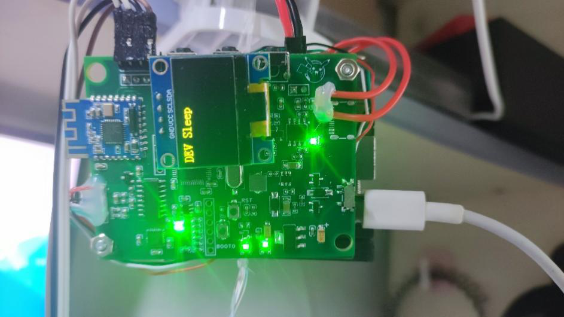
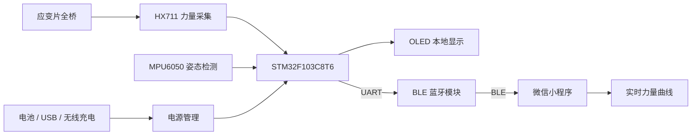
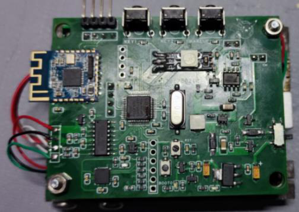
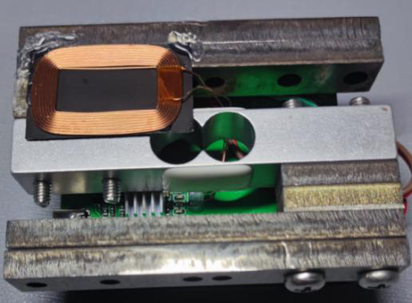
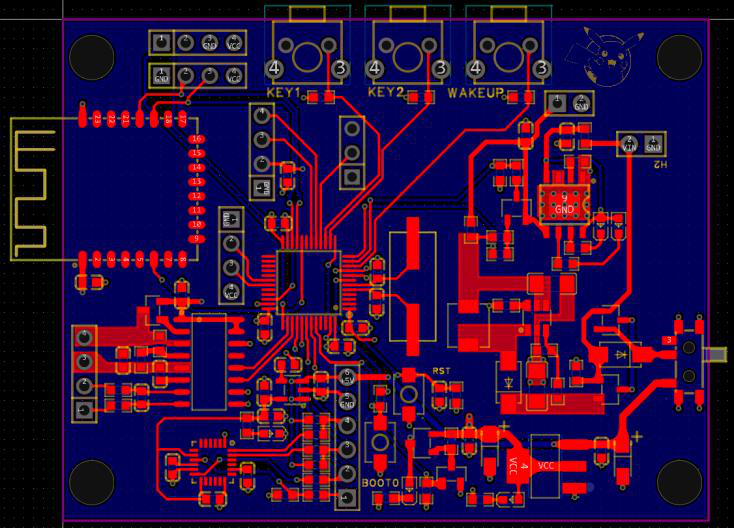
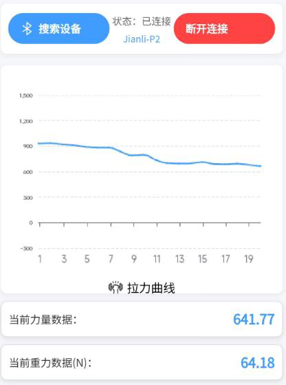

# 基于 STM32 的智能健身拉力器 | STM32 Smart Fitness Trainer

> 本科毕业设计（2024—2025）｜嵌入式软硬件开发 · 传感器数据采集 · BLE 通信 · 微信小程序

本项目设计并制作了一款**便携式智能健身拉力器**，以 **STM32F103C8T6** 为主控，结合**应变片测力桥 + HX711** 实现力量数据采集，利用 **MPU6050** 获取设备姿态，并通过 **OLED** 提供本地显示和异常姿态提示。系统还可通过 **BLE 蓝牙**将力量数据传输至**微信小程序**，实时绘制力量变化曲线。

项目覆盖需求分析、器件选型、电路设计、PCB 制作、嵌入式固件、无线通信、小程序交互及整机调试，属于软硬件结合的完整毕业设计实践。



## ✨ 主要功能

| 模块 | 实现内容 |
| --- | --- |
| 主控系统 | STM32F103C8T6，基于 STM32 HAL 库开发 |
| 力量检测 | 电阻应变片全桥测力结构，HX711 24 位 ADC 采样，零点校准与力量计算 |
| 姿态检测 | MPU6050 惯性传感器，获取姿态角，并进行阈值判断和异常提示 |
| 无线通信 | STM32 通过 UART 对接 BLE 模块，向微信小程序发送力量数据 |
| 本地交互 | OLED 显示电量、力量及姿态信息，并显示异常提醒 |
| 移动端显示 | 微信小程序连接 BLE 设备，基于 ECharts 展示实时力量曲线 |
| 电源与硬件 | 锂电池管理、USB / 无线充电、电源切换和自制 PCB |

**关于测量范围：**项目最初设计目标为 **0～1000 N**；毕业论文的最终成果部分说明，受机械结构限制，实物实现的力量测量范围约为 **0～500 N**。精度和分辨力的设计指标尚不应视为经过独立量化验证的实测结论。

## 🎬 项目演示

https://github.com/user-attachments/assets/b8e3be15-2185-4d96-9d1e-883a80368c0f

<!-- 若希望视频在 GitHub README 页面内直接播放：请在 GitHub 网页编辑 README，拖入本地 MP4 获取 https://github.com/user-attachments/assets/... 地址，再将该完整地址单独放在本段下一行，前后留空行。不要直接用仓库 raw MP4 路径充当嵌入播放器。 -->

## 🧩 系统整体架构



### 关键实现思路

**1. 力量采集与标定**  
使用定制测力结构和电阻应变片全桥，将受力引起的微小电压变化送入 HX711。STM32 按芯片时序读取 24 位采样数据，并结合零点偏移量及转换系数计算力量值。

**2. 姿态检测与反馈**  
通过 MPU6050 读取惯性传感器数据，计算设备姿态角；当角度超过设定阈值时，在 OLED 上提示姿态异常。这里的姿态提示基于设备角度阈值，不等同于对人体动作标准性的完整识别。

**3. 蓝牙传输与小程序可视化**  
STM32 通过串口输出包含力量数值的文本信息，BLE 模块发送至手机端；小程序在收到特征值通知后提取力量数据，并更新 ECharts 曲线。

## 📷 实物与测试展示

| PCB / 硬件正面 | 测力结构 / 硬件背面 |
| :---: | :---: |
|  |  |

| PCB 布局图 | 微信小程序力量曲线 |
| :---: | :---: |
|  |  |

以上图片来源于毕业设计论文中的实物、PCB 和功能测试记录。当前仓库提供了相关展示图片，但**未提供可直接编辑的原理图或 PCB 工程源文件**。

## 🛠️ 开发环境与技术栈

| 分类 | 技术 |
| --- | --- |
| 主控芯片 | STM32F103C8T6（ARM Cortex-M3） |
| 嵌入式开发 | C、STM32CubeMX、STM32 HAL、Keil MDK-ARM |
| 测力器件 | HX711、应变片测力桥 |
| 姿态检测 | MPU6050、I²C |
| 通信方式 | UART、BLE 蓝牙 |
| 本地界面 | OLED 显示屏 |
| 移动端 | 微信小程序、JavaScript、WXML、WXSS、ECharts |
| 电源管理 | TP4056、MT3608、NU1680 等相关电路方案 |

## 📁 仓库目录

```text
STM32-Smart-Fitness-Trainer/
├── P1/                         # STM32 固件与 Keil 工程
│   ├── 111.ioc                 # STM32CubeMX 配置文件
│   ├── Core/
│   │   ├── Inc/                # 应用头文件
│   │   └── Src/                # 驱动与应用源码
│   ├── Drivers/                 # HAL / CMSIS 依赖
│   └── MDK-ARM/                 # Keil MDK 项目文件
├── 微信程序/                    # 微信小程序源码
│   ├── pages/                  # 页面与业务逻辑
│   ├── ec-canvas/              # ECharts 小程序适配
│   └── app.js                  # 小程序入口
├── 演示视频.mp4                # 整机功能演示
├── docs/
│   └── images/                 # 实物、PCB、小程序截图（本 README 素材包提供）
├── .gitignore                  # Git 忽略规则
└── README.md                   # 项目说明
```

## 🚀 工程打开与运行

### STM32 固件

1. 安装 Keil MDK-ARM 及适用于 STM32F1 的设备支持包。
2. 使用 Keil 打开 `P1/MDK-ARM/111.uvprojx`。
3. 如需修改时钟或外设配置，可参考 `P1/111.ioc`，使用 STM32CubeMX 查看配置。
4. 检查原理图、引脚连接、编译器版本及下载器配置后，编译并烧录至配套的自制 PCB。

> 本工程面向原有定制硬件，不能保证直接在通用 STM32F103 开发板上运行。整理发布时未重新完成编译与整机验证。

### 微信小程序

1. 使用微信开发者工具导入 `微信程序/` 目录。
2. 按实际需要检查项目 AppID、相关权限及依赖配置。
3. 在支持 BLE 的手机上进行真机调试，搜索并连接对应蓝牙设备。
4. 进入力量数据显示界面，查看设备传入的力量数据和曲线。

> BLE 通信与传感器显示需要实物设备配合。仓库中的小程序保留了原始项目结构，部分交互逻辑仍有优化空间。

## ✅ 项目完成情况与后续改进

毕业论文记录了主控、锂电池供电、无线充电、HX711 测力、MPU6050 姿态检测、OLED 显示、BLE 通信及小程序曲线等模块的调试与功能验证。

后续计划重点改进：

- **测力校准**：检查零点标定中的样本筛选逻辑，增加标准载荷的多点标定与误差统计。
- **BLE 稳定性**：完善断线重连、通知订阅管理及小程序手动扫描事件。
- **姿态算法**：进一步完善姿态滤波和阈值判断，降低误报。
- **低功耗验证**：通过实测电流评估待机、唤醒和电源管理策略。
- **工程资料**：条件允许时补充可编辑 PCB/原理图、测试数据及更加完整的开发记录。

## 📄 项目说明

本仓库用于展示和归档本科毕业设计成果。项目中的 STM32 HAL、CMSIS、姿态驱动和 ECharts 等组件可能涉及第三方许可；使用、修改或二次分发前，请检查相应许可及学校、合作者对项目资料的公开要求。

---

**关键词：** `STM32` · `Embedded C` · `HX711` · `MPU6050` · `BLE` · `WeChat Mini Program` · `PCB Design`
